# Redes Neuronales 1002: temas avanzados y actuales

La edición en español del curso: dieciséis notebooks de Jupyter sobre lo que viene después de las bases: cómo se alinean y se ajustan los modelos de lenguaje, qué hace eficientes a las arquitecturas y al entrenamiento, cómo se generan imágenes, sonido y voz, cómo tratan las redes neuronales los grafos y la física, cómo explicar, calibrar, auditar y proteger un modelo, cómo arreglar los datos en vez del modelo, cómo usan herramientas los agentes y hacia dónde van los modelos generalistas. El último módulo es un caso narrativo sobre problemas reales de energía eólica, con cinco notebooks incluidos. Cada idea se construye a una escala que una CPU de portátil puede entrenar, se mide contra una referencia honesta y se compara con un modelo real preentrenado cuando es lo bastante pequeño para ejecutarse. No hace falta GPU ni claves de API.

**Requisito previo:** es la continuación del curso introductorio de redes neuronales, de bases y visión de conjunto ([neural-networks.academy.forwardforecasting.eu/es/](https://neural-networks.academy.forwardforecasting.eu/es/), código en [`../../neural-networks/es/`](../../neural-networks/es/)): neuronas, retropropagación, entrenar bien, aprendizaje por refuerzo, convoluciones, redes recurrentes, el transformer y un GPT. Cada notebook indica en qué módulos de ese curso se apoya, con enlaces.

**Sitio web del curso:** [neural-networks-1002.academy.forwardforecasting.eu/es/](https://neural-networks-1002.academy.forwardforecasting.eu/es/) muestra cada notebook con sus resultados guardados, el temario, el seguimiento del progreso y enlaces para descargar o abrir en Colab.

## Índice

- [Los notebooks](#los-notebooks)
- [Ruta de aprendizaje](#ruta-de-aprendizaje)
- [Flujo de datos](#flujo-de-datos)
- [Librerías y técnicas explicadas](#librerías-y-técnicas-explicadas)
- [Por qué estos modelos y conjuntos de datos](#por-qué-estos-modelos-y-conjuntos-de-datos)
- [Cómo empezar](#cómo-empezar)
- [Sobre la traducción](#sobre-la-traducción)
- [Tiempo de ejecución y coste](#tiempo-de-ejecución-y-coste)
- [Referencias](#referencias)
- [Contacto](#contacto)

## Los notebooks

El tiempo en CPU es el medido al ejecutar el notebook completo en un entorno gratuito de Google Colab (2 CPU virtuales, sin GPU), redondeado y sin las descargas de la primera vez; tu portátil puede ser más rápido o más lento.

| # | Notebook | Qué construyes | Ideas clave | Tiempo en CPU |
|---|---|---|---|---|
| 01 | [`01_rlhf_y_alineacion.ipynb`](01_rlhf_y_alineacion.ipynb) | Todo el flujo de postentrenamiento a escala de juguete: un GPT diminuto, ajuste fino supervisado, un modelo de recompensa, ajuste con gradiente de política, DPO y GRPO | modelo de recompensa de Bradley-Terry, penalización KL, recorte de PPO, sobreoptimización (ley de Goodhart), DPO, GRPO con recompensa verificable | ~2 min |
| 02 | [`02_modelos_abiertos_y_ajuste_fino.ipynb`](02_modelos_abiertos_y_ajuste_fino.ipynb) | Checkpoints reales cargados y ajustados en un portátil, LoRA desde cero y con `peft`, modelos guardados y exportados | abierto frente a pesos abiertos, licencias, cuantización, sonda lineal y ajuste parcial o total, LoRA y QLoRA, safetensors, ONNX, fichas de modelo | ~4 min |
| 03 | [`03_arquitecturas_eficientes_y_escala.ipynb`](03_arquitecturas_eficientes_y_escala.ipynb) | Una calculadora de coste, FlashAttention por bloques, atención por grupos de consultas, una mezcla de expertos, un modelo de espacio de estados y paralelismo de datos en varios procesos de CPU | regla de coste 6ND, tamaño de la caché KV, RoPE, colapso de expertos, S4 y Mamba, precisión mixta, ZeRO/FSDP, decodificación especulativa, energía y coste | ~8 min |
| 04 | [`04_autoencoders_gans_y_autosupervisado.ipynb`](04_autoencoders_gans_y_autosupervisado.ipynb) | Un autoencoder, un VAE, una GAN, un aprendiz tipo SimCLR y un CLIP en miniatura junto a uno real | cuello de botella y anomalías, ELBO, colapso de modos, InfoNCE, curvas de sonda lineal, clasificación zero-shot | ~1 min |
| 05 | [`05_modelos_de_difusion.ipynb`](05_modelos_de_difusion.ipynb) | Un modelo de difusión desde cero con dígitos, muestreo más rápido, guiado y una versión latente | ruido progresivo, calendarios de ruido, U-Net de eliminación de ruido, DDPM y DDIM, guiado sin clasificador, difusión latente | ~3 min |
| 06 | [`06_generacion_de_audio_y_video.ipynb`](06_generacion_de_audio_y_video.ipynb) | Espectrogramas y códecs, modelos de tokens y de difusión para sonido, un modelo de música real y un juguete de difusión de vídeo | STFT y mel, EnCodec, Griffin-Lim y HiFi-GAN, distancia de Fréchet, MusicGen, coherencia temporal, flujo óptico, marcas de agua | ~17 min |
| 07 | [`07_voz_reconocimiento_sintesis_y_clonacion.ipynb`](07_voz_reconocimiento_sintesis_y_clonacion.ipynb) | Un reconocedor de voz CTC desde cero y después Whisper, wav2vec 2.0 y modelos de síntesis reales, medidos | pérdida CTC, decodificación voraz y en haz, tasa de error de palabras, alucinaciones de Whisper en silencio, cascada de traducción, embeddings de locutor, clonación de voz y su ética | ~12 min |
| 08 | [`08_redes_neuronales_de_grafos.ipynb`](08_redes_neuronales_de_grafos.ipynb) | Capas GCN, GraphSAGE, GAT y GIN en PyTorch puro, con una red generada y con moléculas reales | paso de mensajes, invariancia a permutaciones, sobresuavizado, lectura de grafo, validación cruzada, resultado honesto frente a referencias simples | ~1 min |
| 09 | [`09_aprendizaje_automatico_cientifico.ipynb`](09_aprendizaje_automatico_cientifico.ipynb) | Un solver de diferencias finitas, PINN para una EDO y la ecuación del calor, un problema inverso, una DeepONet y un operador neuronal de Fourier | física en la pérdida, pesos de la pérdida, sesgo espectral, entrenamiento causal, aprendizaje de operadores, modelos científicos grandes | ~9 min |
| 10 | [`10_interpretabilidad_y_explicabilidad.ipynb`](10_interpretabilidad_y_explicabilidad.ipynb) | Métodos de atribución en datos tabulares, visión y lenguaje, cada uno contrastado con una verdad conocida, y un primer vistazo a la interpretabilidad mecanicista | importancia por permutación, gradientes integrados, valores de Shapley, LIME, Grad-CAM, pruebas de cordura, sondas, cabezas de inducción, autoencoders dispersos | ~3 min |
| 11 | [`11_incertidumbre_calibracion_y_robustez.ipynb`](11_incertidumbre_calibracion_y_robustez.ipynb) | Clasificadores calibrados, con incertidumbre y sometidos a ataques | aleatoria y epistémica, ECE, escalado de temperatura, ensembles, dropout de Monte Carlo, predicción conforme, FGSM y PGD, entrenamiento adversario | ~25 s |
| 12 | [`12_ia_responsable.ipynb`](12_ia_responsable.ipynb) | Mediciones de equidad, privacidad y seguridad con datos de un censo y modelos de lenguaje pequeños | paridad demográfica, resultado de imposibilidad, inferencia de pertenencia, DP-SGD, red teaming, marcas de agua en texto, fichas de modelo, marco regulatorio, energía | ~5 min |
| 13 | [`13_ia_centrada_en_datos.ipynb`](13_ia_centrada_en_datos.ipynb) | Experimentos de ruido en etiquetas, fugas, valoración de datos y aprendizaje activo con el modelo fijo | coste de las etiquetas ruidosas, aprendizaje confiado, kappa de Cohen, duplicados, curvas de aprendizaje, aprendizaje activo, supervisión débil, monitorización | ~5 min |
| 14 | [`14_agentes_y_orquestacion.ipynb`](14_agentes_y_orquestacion.ipynb) | Agentes con herramientas, memoria y planificación alrededor de un modelo simulado, y siete patrones de orquestación medidos sobre las mismas tareas | llamadas a funciones, ReAct, barreras de seguridad, supervisor, planificador jerárquico, bucle crítico, pass@k, MCP, inyección de prompts | ~10 s |
| 15 | [`15_modelos_generalistas_y_agi.ipynb`](15_modelos_generalistas_y_agi.ipynb) | Un transformer pequeño que lee imágenes y palabras en un solo flujo de tokens y un experimento de escalado con una extrapolación comprobada | tokens multimodales, leyes de escalado, emergencia, razonamiento, modelos del mundo, qué significa AGI | ~2 min |
| 16 | [`16_casos_reales_energia_eolica.ipynb`](16_casos_reales_energia_eolica.ipynb) | **Módulo narrativo final:** cinco problemas reales de energía eólica, cada uno con una tecnología frente a un método clásico | PINN para el perfil del viento, GNN con estelas, rosa espectral del oleaje, XGBoost frente a PyTorch, CNN con imágenes SAR, resultados negativos, licencias | ~5 s (sin experimentos nuevos) |

Cada notebook acaba con ideas clave y ejercicios, y está guardado **con sus resultados**.

**Módulo 16 y `wind_cases/`.** La carpeta [`../wind_cases/`](../wind_cases/) contiene cinco notebooks en español con datos eólicos abiertos reales, ya ejecutados, con los datos pequeños en `wind_cases/datos/`. El módulo 16 es la narración sobre ellos y comprueba con código cada cifra que cita. Parte de esos datos tiene licencia de uso no comercial; lee el módulo y el [`README`](../wind_cases/README.md) de esa carpeta antes de reutilizar o publicar algo.

## Ruta de aprendizaje

```
 Parte 1 · Adaptar y alinear           Parte 2 · Representaciones y generación      Parte 3 · Otras arquitecturas
 01 RLHF, DPO, GRPO                    04 Autoencoders, VAEs, GANs, CLIP            08 Redes neuronales de grafos
   ▼                                     ▼                                            ▼
 02 Modelos abiertos, LoRA, exportar   05 Modelos de difusión                        09 ML científico: PINN, operadores
   ▼                                     ▼
 03 Arquitecturas eficientes, escala   06 Generación de audio y vídeo
                                         ▼
                                       07 Voz: reconocimiento, síntesis, clonación

 Parte 4 · IA fiable y responsable             Parte 5 · Sistemas y horizonte       Parte 6 · Proyecto final
 10 Interpretabilidad y explicabilidad         14 Agentes y orquestación            16 Casos reales en energía eólica
   ▼                                             ▼
 11 Incertidumbre, calibración, robustez       15 Modelos generalistas y AGI
   ▼
 12 IA responsable
   ▼
 13 IA centrada en los datos
```

Las partes son casi independientes: tras el curso previo puedes hacer la 2, la 3 o la 4 en cualquier orden. Dentro de una parte, sigue el orden. El módulo 06 supone el 04 y el 05, el 12 supone el 10 y el 11, y el 16 remite a los módulos 08, 09 y 11.

## Flujo de datos

```mermaid
flowchart LR
    subgraph Data["Datos (casi todos generados o incluidos)"]
        D1[tarea de texto y ordenación<br/>nb 01, 15]
        D2[dígitos de sklearn 8x8<br/>nb 04, 05, 11, 13, 15]
        D3[modelos públicos de texto, imagen y voz<br/>Hugging Face, en caché una vez<br/>nb 02, 03, 04, 06, 07, 10]
        D4[conjuntos abiertos pequeños<br/>MUTAG, UCI Adult, Banking77,<br/>dígitos hablados, LibriSpeech<br/>nb 02, 07, 08, 10, 12]
        D5[física y tareas simuladas<br/>nb 09, 14]
        D6[datos abiertos de parques eólicos y oleaje<br/>wind_cases, nb 16]
    end
    Data --> M[Entrenar desde cero<br/>o cargar un checkpoint]
    M --> A[Adaptar o generar<br/>ajustar, alinear, muestrear]
    A --> E[Medir contra una referencia<br/>datos reservados, semillas fijas]
    E --> X[Mirar dentro y someter a estrés<br/>atribución, calibración, ataques,<br/>equidad, privacidad]
    X --> R[Informar con honestidad<br/>incluidos los resultados negativos]
```



## Librerías y técnicas explicadas

| Librería | Se usa para | Por qué |
|---|---|---|
| **PyTorch** (CPU) | Todos los notebooks | Diferenciación automática, capas listas y la misma API de los modelos grandes; `torch.distributed` para paralelismo de datos real en procesos de CPU (módulo 03) |
| **NumPy**, **SciPy** | Numérica, solvers, procesado de señal, estadística | Las referencias clásicas (diferencias finitas, espectros, optimización) con las que se compara cada método neuronal |
| **scikit-learn** | Dígitos incluidos, referencias, particiones, métricas | Conjuntos pequeños y sin conexión, evaluación estándar |
| **transformers**, **huggingface_hub**, **safetensors** | Cargar modelos preentrenados reales (BERT-Mini, DistilBERT, CLIP, Whisper, wav2vec 2.0, SpeechT5, un modelo pequeño de mezcla de expertos y uno de Mamba) | Los checkpoints reales muestran lo que los juguetes no pueden |
| **peft**, **ONNX**, **ONNX Runtime**, **onnxscript** | LoRA y exportación en el módulo 02 | Implementaciones de referencia contra las que contrastar las nuestras |
| **diffusers** (opcional) | Una canalización real de texto a imagen en el módulo 05 | Muestra cómo se ensamblan en un sistema real las piezas hechas desde cero |
| **soundfile**, **speechbrain**, **sentencepiece**, **sacremoses** | Audio, embeddings de locutor y tokenizadores de los modelos de voz y traducción | Los notebooks de voz necesitan herramientas de audio reales |
| **pandas**, **pyarrow**, **scikit-image**, **XGBoost** | Tablas, fotos de ejemplo incluidas y la referencia de gradient boosting | Referencias honestas y datos reales pequeños |
| **SHAP**, **cleanlab**, **Opacus** (opcionales) | Contrastar nuestras implementaciones en los módulos 10, 13 y 12 | Un método propio solo merece confianza cuando coincide con la librería de referencia |
| **Matplotlib**, **Jupyter**, **nbconvert** | Gráficas, formato de notebook y web del curso | Estándar y todo en un documento |

## Por qué estos modelos y conjuntos de datos

- **Pequeños a propósito, reales donde encaja.** Los mecanismos (un modelo de recompensa, un eliminador de ruido, una capa de paso de mensajes, una PINN, una pérdida CTC) se entrenan desde cero con problemas de juguete para ver cada paso. Donde existe un modelo real pequeño, el notebook también lo ejecuta y los pone lado a lado.
- **Semillas fijas y referencias en todas partes.** Cada comparación incluye el método simple (un modelo lineal, un solver clásico, XGBoost, muestreo aleatorio) y dice claramente cuándo pierde el método de moda.
- **Datos abiertos con licencia indicada.** La mayoría usa los dígitos manuscritos de UCI (Alpaydin y Kaynak, CC BY 4.0). Los demás, conjuntos abiertos pequeños con su crédito donde se usan: moléculas MUTAG, UCI Adult, Banking77, Free Spoken Digit Dataset (CC BY-SA 4.0) y datos de parques eólicos en Zenodo (CC BY 4.0).
- **Las licencias son parte de la lección.** Algunos modelos preentrenados son de uso no comercial o restringido (por ejemplo, los pesos de MusicGen, CC BY-NC 4.0) y algunos datos eólicos también. Cada notebook lo dice junto al modelo o al archivo.
- **Simulación donde solo una simulación puede responder.** Los agentes del módulo 14 usan un modelo simulado con tasas de error documentadas y con semilla, porque solo así se pueden comparar los patrones de orquestación con justicia; el notebook lo dice en sus primeras líneas.
- **Alcance honesto.** El módulo de modelos generalistas separa lo medido y publicado de lo especulativo y no da fechas ni probabilidades para la AGI.
- **Sin sector hasta el final.** Los módulos 01 a 15 usan dominios genéricos; el 16 va a un sector real y se pregunta cuándo ganó la red neuronal y cuándo un método más simple lo hizo mejor.

## Cómo empezar

Requisitos: Python 3.10 o superior.

```bash
git clone https://github.com/fborbon/academy.git
cd academy/neural-networks-1002/es
python3 -m venv .venv && source .venv/bin/activate
pip install -r ../requirements.txt
jupyter lab
```

El archivo de requisitos marca las librerías pesadas opcionales. Un notebook que necesita una librería opcional que falta lo dice y omite esa sección.

**Nota sobre `torchaudio`.** Cuando se escribió el curso, torch 2.15 no tenía una rueda de `torchaudio` compatible en el índice de CPU. SpeechBrain solo necesita que el módulo exista para la inferencia, así que el módulo 07 instala un sustituto mínimo si `torchaudio` falta o no coincide. En un portátil normal con un par torch y torchaudio compatible, instala ambos del mismo índice y no se usa el sustituto.

Abre los notebooks en el orden de la ruta de aprendizaje y ejecútalos de uno en uno. **Descargas:** varios notebooks descargan una vez modelos preentrenados o conjuntos pequeños y los guardan en caché (el de voz, unos 3 GB); cada notebook dice qué va a descargar en su primera celda. Todo lo demás funciona sin conexión.

## Sobre la traducción

Estos notebooks se generan con los mismos scripts que la edición en inglés, y el código es idéntico: solo se traducen las explicaciones, los comentarios y las etiquetas de las gráficas. Algunos datos y modelos se quedan en inglés a propósito (corpus, modelos preentrenados); cada notebook explica por qué. Los cinco notebooks de `wind_cases/` están escritos en español y son los mismos en ambas ediciones. La documentación técnica completa está en el [README principal](../README.md), en inglés.

## Tiempo de ejecución y coste

Todo el curso se ejecuta en local, en la CPU de un portátil normal. **No hay APIs de pago**: ni modelos de lenguaje alojados, ni claves de API, ni entrenamiento en la nube. Los modelos preentrenados se descargan una vez y se ejecutan en local.

| Concepto | Coste |
|---|---|
| Llamadas a APIs de IA | ninguna (0 $) |
| Cómputo para ejecutar los notebooks | tu propio equipo: muy aproximadamente de 4 a 5 horas para los dieciséis de principio a fin en un portátil de 8 núcleos (los de voz, audio y vídeo son los más largos, de 25 a 30 minutos cada uno); lo mismo para la edición en inglés |
| Disco | unos 15 MB de notebooks por idioma, más los modelos y datos en caché (unos pocos gigabytes si ejecutas todos, sobre todo los módulos 03, 06 y 07) |

Como dato aparte sobre cómo se produjo el curso, no algo que necesites: los autores ejecutaron los notebooks más pesados (y las ediciones en español) en una instancia efímera de 32 vCPU en la nube que se apagaba sola al quedar inactiva, y varios tiempos de los notebooks proceden de esa máquina; la tabla de arriba los escala a un portátil. Una instancia de ese tamaño cuesta alrededor de 2 $ por hora, y el total de crear y reejecutar los dos cursos fue del orden de decenas de dólares, una estimación aproximada y no una factura. Puedes reproducir todos los resultados en un portátil, solo que con más lentitud.

## Referencias

Cada notebook termina con su propia lista de referencias con enlaces directos. La lista de los artículos principales, también con enlaces, está en el [README principal](../README.md#references), en inglés, que es el idioma en que se publican.

## Contacto

Preguntas o sugerencias: forwardforecasting@gmail.com
