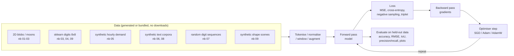
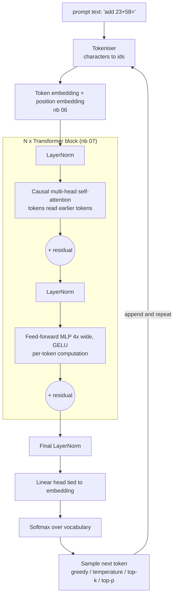

# Neural Networks 1001: From One Neuron to GPT

Nine hands-on Jupyter notebooks that build modern deep learning from first principles. Each one starts where the previous one stopped and ends with something that trains and runs on a laptop CPU, with no GPU, no API keys and no dataset downloads.

**Course website:** [neural-networks.academy.forwardforecasting.eu](https://neural-networks.academy.forwardforecasting.eu/) renders every notebook with its saved outputs, a syllabus, progress tracking, and download / Open-in-Colab links.

## Table of Contents

- [The notebooks](#the-notebooks)
- [Learning path](#learning-path)
- [Data flow](#data-flow)
- [How a GPT is put together](#how-a-gpt-is-put-together)
- [Libraries and techniques explained](#libraries-and-techniques-explained)
- [Why these models and datasets](#why-these-models-and-datasets)
- [Repository layout](#repository-layout)
- [Getting started](#getting-started)
- [The course website and its deployment](#the-course-website-and-its-deployment)
- [Runtime and cost](#runtime-and-cost)
- [References](#references)
- [Contact](#contact)

## The notebooks

| # | Notebook | What you build | Key ideas | CPU time |
|---|---|---|---|---|
| 01 | [`01_the_neuron.ipynb`](01_the_neuron.ipynb) | A neuron in NumPy, trained with the perceptron rule and gradient descent | weighted sum, step / sigmoid / tanh / ReLU / Leaky ReLU / ELU / GELU / SiLU / softmax, derivatives, vanishing gradients, dead ReLUs, why XOR needs more than one neuron | < 30 s |
| 02 | [`02_neural_network_backprop.ipynb`](02_neural_network_backprop.ipynb) | A micrograd-style autograd engine and a vectorised MLP with hand-written backprop | computational graphs, chain rule, gradient checking, SGD / Momentum / Adam, He initialisation, learning rate, PyTorch cross-check | < 1 min |
| 03 | [`03_training_deep_networks.ipynb`](03_training_deep_networks.ipynb) | Diagnose and fix over- and underfitting on moons and digits; a hand-written dropout and batch norm; a hyperparameter search; a train/dev mismatch experiment | train / dev / test, bias and variance, learning curves, weight decay, dropout, early stopping, batch normalisation, mini-batch size, warm-up + cosine schedules, grid vs random search, error analysis, train-dev sets and data mismatch | ~7 min |
| 04 | [`04_convolutional_networks.ipynb`](04_convolutional_networks.ipynb) | A CNN for handwritten digits, then deeper and more efficient ones | convolution from scratch, pooling, feature maps, data augmentation, residual connections (a 20-layer plain net vs a ResNet), transfer learning with few labels, 1×1 and depthwise-separable convolutions | ~2.5 min |
| 05 | [`05_recurrent_networks.ipynb`](05_recurrent_networks.ipynb) | RNN and LSTM forecasters for a demand-like time series, and a day-ahead forecaster | the recurrent loop, BPTT, LSTM gates, calendar features, seasonal-naive baseline, measuring vanishing gradients through time, the forget-gate bias, recursive vs direct multi-horizon forecasting | < 1 min |
| 06 | [`06_embeddings_and_seq2seq.ipynb`](06_embeddings_and_seq2seq.ipynb) | Word embeddings trained from scratch, then a GRU encoder-decoder with attention for English to Spanish | skip-gram with negative sampling, cosine similarity, analogies, measuring and neutralising a planted gender bias, teacher forcing, Bahdanau attention, beam search vs greedy decoding | ~4 min |
| 07 | [`07_transformer.ipynb`](07_transformer.ipynb) | Every transformer component in NumPy, then a full encoder-decoder transformer in PyTorch that learns to sort | embeddings, positional encoding, scaled dot-product attention, masks, multi-head attention, the feed-forward MLP, residual stream, LayerNorm, attention rollout, gradient saliency | ~3 min |
| 08 | [`08_gpt_from_scratch.ipynb`](08_gpt_from_scratch.ipynb) | A character-level GPT pre-trained on a multi-task text corpus that becomes a small "generalist" | BPE tokenisation, decoder-only architecture, next-token prediction, emergent per-task skills, temperature / top-k / top-p sampling, KV cache, fine-tuning vs training from scratch, catastrophic forgetting, scaling laws, from base model to assistant | ~16 min |
| 09 | [`09_vision_beyond_classification.ipynb`](09_vision_beyond_classification.ipynb) | A U-Net segmenter, a YOLO-style detector and a triplet-loss embedding, on synthetic shape scenes and digits | transposed convolutions, skip connections, per-class IoU, grid-based detection, non-maximum suppression, precision and recall, metric learning, one-shot recognition of unseen classes | ~6 min |

Each notebook ends with key takeaways and exercises. The notebooks are saved **with their outputs**, so you can read them on GitHub, on the course website, or in any notebook viewer without running anything.

## Learning path

```
 Part 1 · Foundations            Part 2 · Classic architectures          Part 3 · Modern deep learning
 01 Neuron                       04 CNNs (images)                        07 Transformer
   ▼                               ▼                                       ▼
 02 Network + Backprop    ──►    05 RNNs (time series)          ──►    08 GPT from scratch
   ▼                               ▼                                       ▼
 03 Training well                06 Embeddings + Seq2seq (text)          09 Segmentation, detection,
    (generalisation)                (first attention)                       metric learning
```

Notebook 09 depends only on 03 and 04, so it can be taken straight after Part 2.

## Data flow

Every model in the series follows the same loop. Only the data and the architecture change.



## How a GPT is put together

The architecture built in notebook 08, reusing the pieces from notebooks 01 to 07:



## Libraries and techniques explained

| Library | Used for | Why |
|---|---|---|
| **NumPy** | Notebooks 01, 02 and the first half of 07 | Every equation is visible as array maths: no framework magic while learning the fundamentals |
| **PyTorch** (CPU build) | Notebooks 03 to 09, plus cross-checks in 01 and 02 | Automatic differentiation (`loss.backward()`), ready-made layers, and the same API used to train real large models |
| **scikit-learn** | Bundled datasets (`load_digits`, `make_moons`, `load_sample_image`), train/test split, confusion matrix | Offline, small, well-known datasets |
| **Matplotlib** | All plots: activation curves, decision boundaries, feature maps, forecasts, embedding maps, attention heatmaps, masks and boxes | Standard, works everywhere, renders inline in the notebook |
| **Jupyter** + **nbconvert** | The notebook format, and rendering the course website | Mixes explanation, maths (LaTeX), code and output in one document |

Key AI techniques, and where each one is introduced:

- **Gradient descent and backpropagation** (01, 02): the training algorithm behind every model here.
- **Automatic differentiation** (02): a 50-line scalar engine shows what PyTorch does internally.
- **Generalisation and regularisation** (03): bias/variance diagnosis, weight decay, dropout, early stopping, batch norm, hyperparameter search, error analysis.
- **Convolution, residual connections and transfer learning** (04): shared local filters for images, skip connections for depth, reusing features when labels are scarce.
- **Recurrence and gating** (05): RNN, LSTM and GRU cells for sequences, and why the forget gate matters.
- **Embeddings** (06): words as vectors learned from context, with their analogies and their biases.
- **Attention** (06, 07): from Bahdanau attention in seq2seq to scaled dot-product, multi-head self-attention.
- **Transformer blocks** (07): attention + feed-forward MLP + residual connections + LayerNorm.
- **Language modelling** (08): next-token prediction on a mixed corpus, the objective that makes GPT a generalist.
- **Dense prediction and metric learning** (09): U-Net segmentation, YOLO-style detection with NMS, triplet-loss embeddings.
- **Interpretability** (04, 06, 07, 08): learned filters, embedding maps, attention maps, attention rollout, gradient saliency.

## Why these models and datasets

- **Small on purpose.** Every model is sized to train on a laptop CPU in minutes while still showing the real behaviour (non-linear boundaries, learned filters, attention that reorders words, skills that appear at different points in training). The code is the same code you would scale up.
- **No downloads.** Datasets are bundled with scikit-learn or generated from simple rules, so the notebooks work offline and give the same results each run (fixed seeds).
- **Baselines included.** The forecaster is compared with a seasonal-naive baseline, the CNN with an MLP, the residual net with a plain net, transfer learning with training from scratch, the triplet embedding with raw pixels. A model is only as good as what it beats.
- **Honest results.** When a technique does not help on these toy problems (beam search on an undertrained translator, a default-initialised LSTM's memory), the notebook says so and explains why, instead of tuning until the expected story appears.
- **Synthetic grammars for language.** A word-embedding corpus with built-in gender, royalty, age and geography structure (plus a deliberately planted occupational bias), and an English to Spanish grammar with conjugation, gender agreement and adjective reordering. Both are small enough to learn in a minute and let us check results exactly.
- **Synthetic shape scenes for vision.** Exact masks and boxes make segmentation and detection metrics exact, without a multi-gigabyte dataset.
- **Sorting for the transformer.** Sorting cannot be memorised (10^10 possible inputs) and forces the model to use attention as a pointer, which makes the attention maps easy to interpret.
- **Multi-task corpus for GPT.** Arithmetic, string reversal, sorting, translation and factual recall written as plain text show the central GPT idea: one model, one objective (predict the next token), many skills selected by the prompt.

## Repository layout

```
neural-networks/
├── 01_ ... 09_*.ipynb      the course, saved with outputs
├── builders/               Python scripts that generate each notebook (source of truth for the text and code)
│   ├── nbhelper.py         md() / code() / save() helpers
│   └── build_01.py ... build_09.py
├── site/                   the course website generator
│   ├── build_site.py       renders the notebooks into site/dist/ (not committed)
│   └── templates/          page layouts, CSS and JS
└── requirements.txt
```

To change a notebook, edit its builder, regenerate and re-execute it:

```bash
python3 builders/build_04.py
jupyter nbconvert --to notebook --execute --inplace 04_convolutional_networks.ipynb
```

## Getting started

Requirements: Python 3.10+.

```bash
git clone https://github.com/fborbon/academy.git
cd academy/neural-networks
python3 -m venv .venv && source .venv/bin/activate
pip install -r requirements.txt
jupyter lab        # or: jupyter notebook
```

Open the notebooks in order. To re-run one from the command line and refresh its saved outputs:

```bash
jupyter nbconvert --to notebook --execute --inplace 01_the_neuron.ipynb
```

Run notebooks one at a time: several PyTorch kernels in parallel compete for the same CPU threads and can each run many times slower.

## The course website and its deployment

`site/build_site.py` renders the executed notebooks with nbconvert's `basic` template (it does **not** re-run them) and wraps them in a course layout: a landing page with the syllabus, one page per module with a module sidebar, an "on this page" table of contents, MathJax for the equations, a download link, an Open-in-Colab link, and progress tracking stored in the visitor's browser.


Preview it locally:

```bash
python3 site/build_site.py
python3 -m http.server -d site/dist 8000     # then open http://localhost:8000
```

The workflow lives at the repository root in `.github/workflows/deploy-neural-networks.yml` and needs one secret, `GH_PAT`, a token with write access to the portfolio site repository.

## Runtime and cost

Everything in the course runs locally on the CPU. There are **no paid APIs**: no Bedrock, no Anthropic API calls, no cloud training.

| Item | Cost |
|---|---|
| LLM / AI API calls | none ($0) |
| Compute to run the notebooks | your own machine, about 40 minutes to run all nine end to end on an 8-core laptop CPU (16 of them in notebook 08) |
| Website hosting | static files on the existing web server that already hosts the other forwardforecasting.eu sites: no new instance, no extra AWS cost |
| DNS | one extra A record in an existing Route 53 hosted zone (no extra charge; the zone's $0.50/month is already paid) |
| TLS certificate | Let's Encrypt, free, renewed automatically |
| CI | GitHub Actions, about 1 minute per deploy, within the free tier |
| Bandwidth | about 7 MB per full read of the course, mostly the notebook figures; negligible at the current traffic |
| Disk | about 7 MB of notebooks plus about 7 MB for the rendered site |

## References

The notebooks are written from the original papers, not from any course material:

- Rumelhart, Hinton & Williams, *Learning representations by back-propagating errors* (1986)
- Srivastava et al., *Dropout* (2014) · Ioffe & Szegedy, *Batch Normalization* (2015) · Bergstra & Bengio, *Random Search for Hyper-Parameter Optimization* (2012)
- He et al., *Deep Residual Learning for Image Recognition* (2015) · Howard et al., *MobileNets* (2017)
- Hochreiter & Schmidhuber, *Long Short-Term Memory* (1997) · Gers, Schmidhuber & Cummins, *Learning to Forget* (2000) · Jozefowicz, Zaremba & Sutskever, *An Empirical Exploration of Recurrent Network Architectures* (2015)
- Mikolov et al., *Distributed Representations of Words and Phrases* (2013) · Bolukbasi et al., *Man is to Computer Programmer as Woman is to Homemaker?* (2016) · Gonen & Goldberg, *Lipstick on a Pig* (2019)
- Sutskever, Vinyals & Le, *Sequence to Sequence Learning* (2014) · Bahdanau, Cho & Bengio, *Neural Machine Translation by Jointly Learning to Align and Translate* (2014)
- Vaswani et al., *Attention Is All You Need* (2017) · Radford et al., *Language Models are Unsupervised Multitask Learners* (2019)
- Ronneberger, Fischer & Brox, *U-Net* (2015) · Redmon et al., *You Only Look Once* (2015) · Schroff, Kalenichenko & Philbin, *FaceNet* (2015)

## Contact

Questions or suggestions: forwardforecasting@gmail.com
