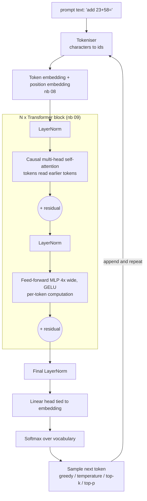

# Neural Networks 1001: From One Neuron to GPT

Twelve hands-on Jupyter notebooks that build modern deep learning from first principles: neurons and backpropagation, how to train a network well, reinforcement learning, convolutions, recurrent networks and time series, classic language models, the transformer and a GPT, vision beyond classification, and a capstone on a real industrial inspection case. Each notebook starts where the previous one stopped and ends with something that trains and runs on a laptop CPU, with no GPU and no API keys. Most notebooks need no download at all; two of them (07 and 12) fetch a real dataset or a pre-trained network once (listed under [Getting started](#getting-started)).

**This is the basics and overview course.** Its advanced sequel (alignment, fine-tuning open models, diffusion, speech, graphs, scientific machine learning, interpretability, uncertainty, responsible AI, agents and real wind-energy cases) is at [neural-networks-1002.academy.forwardforecasting.eu](https://neural-networks-1002.academy.forwardforecasting.eu/), source in [`../neural-networks-1002/`](../neural-networks-1002/).

**Course website:** [neural-networks.academy.forwardforecasting.eu](https://neural-networks.academy.forwardforecasting.eu/) renders every notebook with its saved outputs, a syllabus, progress tracking, and download / Open-in-Colab links.

**Versión en español:** the whole course is also available in Spanish, notebooks included, at [neural-networks.academy.forwardforecasting.eu/es/](https://neural-networks.academy.forwardforecasting.eu/es/) and in the [`es/`](es/) folder.

## Table of Contents

- [The notebooks](#the-notebooks)
- [Learning path](#learning-path)
- [Data flow](#data-flow)
- [How a GPT is put together](#how-a-gpt-is-put-together)
- [Libraries and techniques explained](#libraries-and-techniques-explained)
- [Why these models and datasets](#why-these-models-and-datasets)
- [Getting started](#getting-started)
- [Runtime and cost](#runtime-and-cost)
- [References](#references)
- [Contact](#contact)

## The notebooks

CPU time is the measured run time of the whole notebook on a free Google Colab runtime (2 virtual CPUs, no GPU), rounded; your laptop may be faster or slower.

| # | Notebook | What you build | Key ideas | CPU time |
|---|---|---|---|---|
| 01 | [`01_the_neuron.ipynb`](01_the_neuron.ipynb) | A neuron in NumPy, trained with the perceptron rule and gradient descent | weighted sum, step / sigmoid / tanh / ReLU / Leaky ReLU / ELU / GELU / SiLU / softmax, derivatives, vanishing gradients, dead ReLUs, why XOR needs more than one neuron | ~5 s |
| 02 | [`02_neural_network_backprop.ipynb`](02_neural_network_backprop.ipynb) | A micrograd-style autograd engine and a vectorised MLP with hand-written backprop | computational graphs, chain rule, gradient checking, SGD / Momentum / Adam, He initialisation, learning rate, PyTorch cross-check | ~10 s |
| 03 | [`03_training_deep_networks.ipynb`](03_training_deep_networks.ipynb) | Diagnose and fix over- and underfitting on moons and digits; a hand-written dropout and batch norm; a hyperparameter search; a train/dev mismatch experiment | train / dev / test, bias and variance, learning curves, weight decay, dropout, early stopping, batch normalisation, mini-batch size, warm-up + cosine schedules, grid vs random search, error analysis | ~45 s |
| 04 | [`04_reinforcement_learning.ipynb`](04_reinforcement_learning.ipynb) | Bandits, tabular Q-learning on a cliff gridworld, REINFORCE and PPO on a cart-pole we write ourselves, and an agent that hacks its reward | exploration vs exploitation (epsilon-greedy, UCB), Q-learning vs SARSA, policy gradient, baselines and variance, actor-critic, the PPO clipped objective, reward hacking, a preview of RLHF | ~40 s |
| 05 | [`05_convolutional_networks.ipynb`](05_convolutional_networks.ipynb) | A CNN for handwritten digits, then deeper and more efficient ones | convolution from scratch, pooling, feature maps, data augmentation, residual connections (a 20-layer plain net vs a ResNet), transfer learning with few labels, 1×1 and depthwise-separable convolutions | ~1 min |
| 06 | [`06_recurrent_networks.ipynb`](06_recurrent_networks.ipynb) | RNN and LSTM forecasters for a demand-like time series, and a day-ahead forecaster | the recurrent loop, BPTT, LSTM gates, calendar features, seasonal-naive baseline, measuring vanishing gradients through time, the forget-gate bias, recursive vs direct multi-horizon forecasting | ~10 s |
| 07 | [`07_time_series_forecasting.ipynb`](07_time_series_forecasting.ipynb) | Neural forecasters on real hourly bike-sharing demand and on simulated river flow, against seasonal baselines and XGBoost, then a pre-trained foundation model used zero-shot | rolling-origin evaluation, direct multi-horizon forecasts, GRU / LSTM / patch Transformer, why XGBoost wins on one problem and a neural model on the other, TimesFM 3 with covariates, quantile (pinball) loss, a decision guide | ~3 min (first run; the foundation-model forecasts are cached afterwards) |
| 08 | [`08_embeddings_and_seq2seq.ipynb`](08_embeddings_and_seq2seq.ipynb) | Word embeddings trained from scratch, then a GRU encoder-decoder with attention for English to Spanish | skip-gram with negative sampling, cosine similarity, analogies, measuring and neutralising a planted gender bias, teacher forcing, Bahdanau attention, beam search vs greedy decoding | ~1 min |
| 09 | [`09_transformer.ipynb`](09_transformer.ipynb) | Every transformer component in NumPy, then a full encoder-decoder transformer in PyTorch that learns to sort | embeddings, positional encoding, scaled dot-product attention, masks, multi-head attention, the feed-forward MLP, residual stream, LayerNorm, attention rollout, gradient saliency | ~60 s |
| 10 | [`10_gpt_from_scratch.ipynb`](10_gpt_from_scratch.ipynb) | A character-level GPT pre-trained on a multi-task text corpus that becomes a small "generalist" | BPE tokenisation, decoder-only architecture, next-token prediction, emergent per-task skills, temperature / top-k / top-p sampling, KV cache, fine-tuning vs training from scratch, catastrophic forgetting, scaling laws, from base model to assistant | ~6 min |
| 11 | [`11_vision_beyond_classification.ipynb`](11_vision_beyond_classification.ipynb) | A U-Net segmenter, a YOLO-style detector and a triplet-loss embedding, on synthetic shape scenes and digits | transposed convolutions, skip connections, per-class IoU, grid-based detection, non-maximum suppression, precision and recall, metric learning, one-shot recognition of unseen classes | ~2 min |
| 12 | [`12_capstone_real_case.ipynb`](12_capstone_real_case.ipynb) | **Capstone on a real case:** an end-of-line visual inspection model for real photos of manufactured blades (good / nick / scratch), worked like a competition entry | a written brief and fixed metric (macro-F1, escape and false-reject rates), a locked test set, 5-fold cross-validation, baselines, a CNN from scratch vs ImageNet transfer learning (frozen features, partial fine-tuning), ensembling and test-time augmentation, a cost-aware reject threshold, bootstrap confidence intervals, Grad-CAM, error analysis, deployment questions | ~14 min |

Each notebook ends with key takeaways and exercises. The notebooks are saved **with their outputs**, so you can read them on GitHub, on the course website, or in any notebook viewer without running anything.

## Learning path

```
 Part 1 · Foundations         Part 2 · Classic architectures                      Part 3 · Transformers and LLMs
 01 Neuron                    05 CNNs (images)                                     09 Transformer
   ▼                            ▼                                                    ▼
 02 Network + Backprop  ──►   06 RNNs (sequences)                           ──►    10 GPT from scratch
   ▼                            ▼                                                    ▼
 03 Training well             07 Time series with neural networks                  11 Segmentation, detection,
    (generalisation)            ▼                                                     metric learning
   ▼                          08 Classic NLP: embeddings, seq2seq, attention
 04 Reinforcement learning
    (learning from rewards)
```

```
 Part 4 · Capstone
 12 Real case: visual defect inspection on a production line
    (baselines, transfer learning, cross-validation, ensembling, thresholds, Grad-CAM)
```

Dependencies are lighter than the numbering suggests. Module 04 needs only 01 to 03, module 07 needs 03, 06 and 09 (the patch Transformer), module 11 needs 03 and 05, and the capstone mainly uses 03, 05 and 11, so it is best taken last. Module 09 builds on the attention of 08.

## Data flow

Every model in the series follows the same loop. Only the data and the architecture change.

```mermaid
flowchart LR
    subgraph Data["Data (mostly generated or bundled)"]
        D1[2D blobs / moons<br/>nb 01-03]
        D2[sklearn digits 8x8<br/>nb 03, 05, 11]
        D3[synthetic environments<br/>bandits, gridworld, cart-pole, nb 04]
        D4[synthetic hourly demand<br/>nb 06]
        D5[bike-sharing demand, CC BY 4.0<br/>+ simulated river flow, nb 07]
        D6[synthetic text corpora<br/>nb 08, 10]
        D7[random digit sequences<br/>nb 09]
        D8[synthetic shape scenes<br/>nb 11]
        D9[real blade photos, CC BY 4.0<br/>downloaded once, nb 12]
    end
    Data --> T[Tokenise / normalise<br/>/ window / augment]
    T --> F[Forward pass<br/>model or policy]
    F --> L[Loss or reward<br/>MSE, cross-entropy,<br/>policy gradient, triplet]
    L --> B[Backward pass<br/>gradients]
    B --> O[Optimiser step<br/>SGD / Adam / AdamW]
    O -->|repeat| F
    F --> E[Evaluate on held-out data<br/>accuracy, RMSE, IoU,<br/>precision/recall, return, plots]
```



## How a GPT is put together

The architecture built in notebook 10, reusing the pieces from notebooks 01 to 09:



## Libraries and techniques explained

| Library | Used for | Why |
|---|---|---|
| **NumPy** | Notebooks 01, 02, 04 and the first half of 09 | Every equation is visible as array maths: no framework magic while learning the fundamentals |
| **PyTorch** (CPU build) | Notebooks 03 to 12, plus cross-checks in 01 and 02 | Automatic differentiation (`loss.backward()`), ready-made layers, and the same API used to train real large models |
| **scikit-learn** | Bundled datasets (`load_digits`, `make_moons`, `load_sample_image`), the bike-sharing download (`fetch_openml`), train/test split, confusion matrix | Small, well-known datasets and standard evaluation helpers |
| **pandas** and **XGBoost** | Notebook 07 | The tabular data frames, and the gradient-boosting baseline a neural forecaster has to beat |
| **TimesFM** (optional) | Notebook 07, section 7 | A pre-trained time-series foundation model used zero-shot; skipped if not installed |
| **torchvision** + **Pillow** | Notebook 12 | An ImageNet-pre-trained ResNet-18 for transfer learning, and reading the inspection photos |
| **Matplotlib** | All plots: activation curves, decision boundaries, learning curves, feature maps, forecasts, embedding maps, attention heatmaps, masks and boxes | Standard, works everywhere, renders inline in the notebook |
| **Jupyter** + **nbconvert** | The notebook format, and rendering the course website | Mixes explanation, maths (LaTeX), code and output in one document |

Key AI techniques, and where each one is introduced:

- **Gradient descent and backpropagation** (01, 02): the training algorithm behind every model here.
- **Automatic differentiation** (02): a 50-line scalar engine shows what PyTorch does internally.
- **Generalisation and regularisation** (03): bias/variance diagnosis, weight decay, dropout, early stopping, batch norm, hyperparameter search, error analysis.
- **Reinforcement learning** (04): bandits, Q-learning, REINFORCE, actor-critic and PPO, and reward hacking: learning from a score instead of from labels.
- **Convolution, residual connections and transfer learning** (05): shared local filters for images, skip connections for depth, reusing features when labels are scarce.
- **Recurrence and gating** (06): RNN, LSTM and GRU cells for sequences, and why the forget gate matters.
- **Forecasting** (06, 07): rolling-origin evaluation, honest baselines, neural models against gradient boosting, a zero-shot foundation model, and prediction bands.
- **Embeddings** (08): words as vectors learned from context, with their analogies and their biases.
- **Attention** (08, 09): from Bahdanau attention in seq2seq to scaled dot-product, multi-head self-attention.
- **Transformer blocks** (09): attention + feed-forward MLP + residual connections + LayerNorm.
- **Language modelling** (10): next-token prediction on a mixed corpus, the objective that makes GPT a generalist.
- **Dense prediction and metric learning** (11): U-Net segmentation, YOLO-style detection with NMS, triplet-loss embeddings.
- **Interpretability** (05, 08, 09, 10, 12): learned filters, embedding maps, attention maps, attention rollout, gradient saliency, Grad-CAM.
- **A real project, end to end** (12): a fixed metric and a locked test set, cross-validation, transfer learning with partial fine-tuning, ensembling and test-time augmentation, a cost-aware decision threshold, bootstrap intervals on the test score, and a three-way ship / reject / human-review routing.

## Why these models and datasets

- **Small on purpose.** Every model is sized to train on a laptop CPU in minutes while still showing the real behaviour (non-linear boundaries, learned filters, attention that reorders words, skills that appear at different points in training). The code is the same code you would scale up.
- **Generated or bundled data for most notebooks.** Datasets ship with scikit-learn or are generated from simple rules, so those notebooks work offline and give the same results each run (fixed seeds).
- **Environments written by hand for reinforcement learning.** The bandits, the cliff gridworld and the cart-pole are a few lines of NumPy each, so there is no game library to install and every reward is exactly what the text says it is.
- **Two forecasting problems with opposite winners.** Real hourly bike-sharing demand (Fanaee-T and Gama, UCI Machine Learning Repository, [dataset page](https://archive.ics.uci.edu/dataset/275/bike+sharing+dataset), CC BY 4.0), where a gradient-boosted model is hard to beat, and a simulated river-flow problem with known truth, where memory matters and the neural models win. The pre-trained TimesFM 3 weights are published under a non-commercial licence, so that part is optional and labelled as such.
- **Real, openly licensed data for the capstone.** Notebook 12 uses the GKN Blade Surface Defect Dataset (Qianyu Zhou, Mendeley Data, 2023, [doi:10.17632/3bh998k78g.1](https://doi.org/10.17632/3bh998k78g.1), CC BY 4.0): 400 real photos of finished blades, 203 good, 48 with nicks, 149 with scratches. It was picked because its licence allows reuse with credit (several better-known inspection datasets are non-commercial or no-derivatives), it is small enough for a CPU, and it has the difficulties of real inspection work: few labelled images, a rare class and tiny defects. The notebook downloads it from the original publication and checks every file's SHA-256 hash.
- **Baselines included.** The forecasters are compared with a seasonal-naive baseline and XGBoost, the CNN with an MLP, the residual net with a plain net, transfer learning with training from scratch, the triplet embedding with raw pixels. A model is only as good as what it beats.
- **Honest results.** When a technique does not help on these toy problems (beam search on an undertrained translator, a default-initialised LSTM's memory, a neural network against XGBoost on bike demand), the notebook says so and explains why, instead of tuning until the expected story appears.
- **Synthetic grammars for language.** A word-embedding corpus with built-in gender, royalty, age and geography structure (plus a deliberately planted occupational bias), and an English to Spanish grammar with conjugation, gender agreement and adjective reordering. Both are small enough to learn in a minute and let us check results exactly.
- **Synthetic shape scenes for vision.** Exact masks and boxes make segmentation and detection metrics exact, without a multi-gigabyte dataset.
- **Sorting for the transformer.** Sorting cannot be memorised (10^10 possible inputs) and forces the model to use attention as a pointer, which makes the attention maps easy to interpret.
- **Multi-task corpus for GPT.** Arithmetic, string reversal, sorting, translation and factual recall written as plain text show the central GPT idea: one model, one objective (predict the next token), many skills selected by the prompt.

## Getting started

Requirements: Python 3.10+.

```bash
git clone https://github.com/fborbon/academy.git
cd academy/neural-networks
python3 -m venv .venv && source .venv/bin/activate
pip install -r requirements.txt
jupyter lab        # or: jupyter notebook
```

Open the notebooks in order. To re-run one from the command line and refresh its saved outputs:

```bash
jupyter nbconvert --to notebook --execute --inplace 01_the_neuron.ipynb
```

Run notebooks one at a time: several PyTorch kernels in parallel compete for the same CPU threads and can each run many times slower.

What is downloaded, and when (everything else needs no network):

| Notebook | Download | Size | Notes |
|---|---|---|---|
| 07 | Bike Sharing data from OpenML, cached by scikit-learn | < 1 MB | needs a connection once |
| 07 | TimesFM 3 weights, optional | 1.3 GB | non-commercial licence; the section is skipped if `timesfm` is not installed |
| 12 | Blade inspection photos | ~80 MB | CC BY 4.0, hash-checked |
| 12 | ResNet-18 ImageNet weights | 45 MB | cached by torchvision |

## Runtime and cost

Everything in the course runs locally on the CPU of an ordinary laptop. There are **no paid APIs**: no hosted language model, no API keys, no cloud training needed.

| Item | Cost |
|---|---|
| LLM / AI API calls | none ($0) |
| Compute to run the notebooks | your own machine: roughly 90 to 100 minutes to run all twelve end to end on an 8-core laptop CPU (about 35 of them in each of notebooks 07 and 12 on a first run, 16 in notebook 10); the same again for the Spanish edition |
| Disk | about 10 MB of notebooks per language; the optional TimesFM weights (1.3 GB), the capstone photos (~80 MB) and ResNet-18 weights (45 MB) are cached once in `~/.cache` |

As an aside on how the course was produced, not something you need: the authors executed the heavier notebooks (and the Spanish editions) on an ephemeral 32-vCPU cloud instance that shut itself down when idle, to save waiting time. That cost on the order of a few dollars per course (an instance of that size is roughly 2 USD per hour), a rough estimate rather than an invoice. You can reproduce every result on a laptop, only more slowly.

## References

The notebooks are written from the original papers, not from any course material:

- Rumelhart, Hinton & Williams, [*Learning representations by back-propagating errors*](https://doi.org/10.1038/323533a0) (1986)
- Srivastava et al., [*Dropout*](https://jmlr.org/papers/v15/srivastava14a.html) (2014) · Ioffe & Szegedy, [*Batch Normalization*](https://arxiv.org/abs/1502.03167) (2015) · Bergstra & Bengio, [*Random Search for Hyper-Parameter Optimization*](https://jmlr.org/papers/v13/bergstra12a.html) (2012)
- Sutton & Barto, [*Reinforcement Learning: An Introduction*](http://incompleteideas.net/book/the-book-2nd.html) (2018) · Watkins & Dayan, [*Q-learning*](https://doi.org/10.1007/BF00992698) (1992) · Williams, [*Simple statistical gradient-following algorithms*](https://doi.org/10.1007/BF00992696) (1992) · Schulman et al., [*Proximal Policy Optimization Algorithms*](https://arxiv.org/abs/1707.06347) (2017) · Amodei et al., [*Concrete Problems in AI Safety*](https://arxiv.org/abs/1606.06565) (2016)
- He et al., [*Deep Residual Learning for Image Recognition*](https://arxiv.org/abs/1512.03385) (2015) · Howard et al., [*MobileNets*](https://arxiv.org/abs/1704.04861) (2017)
- Hochreiter & Schmidhuber, [*Long Short-Term Memory*](https://doi.org/10.1162/neco.1997.9.8.1735) (1997) · Gers, Schmidhuber & Cummins, [*Learning to Forget*](https://doi.org/10.1162/089976600300015015) (2000) · Jozefowicz, Zaremba & Sutskever, [*An Empirical Exploration of Recurrent Network Architectures*](https://proceedings.mlr.press/v37/jozefowicz15.html) (2015)
- Chen & Guestrin, [*XGBoost: A Scalable Tree Boosting System*](https://arxiv.org/abs/1603.02754) (2016) · Das et al., [*A decoder-only foundation model for time-series forecasting*](https://arxiv.org/abs/2310.10688) (2024) · Nie et al., [*A Time Series is Worth 64 Words (PatchTST)*](https://arxiv.org/abs/2211.14730) (2023)
- Mikolov et al., [*Distributed Representations of Words and Phrases*](https://arxiv.org/abs/1310.4546) (2013) · Bolukbasi et al., [*Man is to Computer Programmer as Woman is to Homemaker?*](https://arxiv.org/abs/1607.06520) (2016) · Gonen & Goldberg, [*Lipstick on a Pig*](https://arxiv.org/abs/1903.03862) (2019)
- Sutskever, Vinyals & Le, [*Sequence to Sequence Learning*](https://arxiv.org/abs/1409.3215) (2014) · Bahdanau, Cho & Bengio, [*Neural Machine Translation by Jointly Learning to Align and Translate*](https://arxiv.org/abs/1409.0473) (2014)
- Vaswani et al., [*Attention Is All You Need*](https://arxiv.org/abs/1706.03762) (2017) · Radford et al., [*Language Models are Unsupervised Multitask Learners*](https://cdn.openai.com/better-language-models/language_models_are_unsupervised_multitask_learners.pdf) (2019)
- Ronneberger, Fischer & Brox, [*U-Net*](https://arxiv.org/abs/1505.04597) (2015) · Redmon et al., [*You Only Look Once*](https://arxiv.org/abs/1506.02640) (2015) · Schroff, Kalenichenko & Philbin, [*FaceNet*](https://arxiv.org/abs/1503.03832) (2015)
- Selvaraju et al., [*Grad-CAM: Visual Explanations from Deep Networks via Gradient-based Localization*](https://arxiv.org/abs/1610.02391) (2017) · Yosinski et al., [*How transferable are features in deep neural networks?*](https://arxiv.org/abs/1411.1792) (2014) · Efron & Tibshirani, [*An Introduction to the Bootstrap*](https://doi.org/10.1201/9780429246593) (1993)
- Data for notebook 07: Fanaee-T, H. and Gama, J. (2013), *Event labeling combining ensemble detectors and background knowledge*, [doi:10.1007/s13748-013-0040-3](https://doi.org/10.1007/s13748-013-0040-3); [Bike Sharing dataset](https://archive.ics.uci.edu/dataset/275/bike+sharing+dataset), UCI Machine Learning Repository, CC BY 4.0
- Data for notebook 12: Zhou, Qianyu (2023), *GKN Blade Surface Defect Dataset*, Mendeley Data, V1, [doi:10.17632/3bh998k78g.1](https://doi.org/10.17632/3bh998k78g.1), CC BY 4.0
- Handwritten digits (notebooks 03, 05, 11): Alpaydin, E. and Kaynak, C., [*Optical Recognition of Handwritten Digits*](https://archive.ics.uci.edu/dataset/80/optical+recognition+of+handwritten+digits), UCI Machine Learning Repository, as bundled with scikit-learn
- Sample photograph `china.jpg` (notebook 05): [danielbuechele, Flickr](https://www.flickr.com/photos/danielbuechele/6061409035/), CC BY 2.0, as bundled with scikit-learn
- Pre-trained ResNet-18 weights (notebook 12): ImageNet weights distributed by torchvision; [He et al. (2015)](https://arxiv.org/abs/1512.03385), [Deng et al. (2009)](https://doi.org/10.1109/CVPR.2009.5206848)
- TimesFM 3 weights (notebook 07, optional): [google/timesfm-3.0-pytorch](https://huggingface.co/google/timesfm-3.0-pytorch), non-commercial licence

## Contact

Questions or suggestions: forwardforecasting@gmail.com
