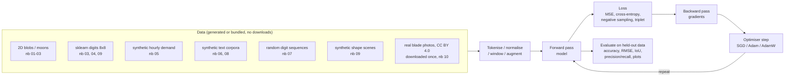
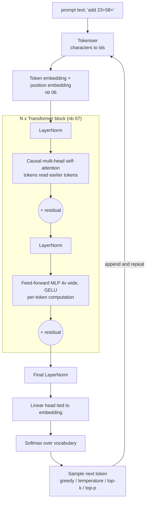

# Neural Networks 1001: From One Neuron to GPT

Nine hands-on Jupyter notebooks that build modern deep learning from first principles, and a tenth that puts it all to work on a real industrial case. Each one starts where the previous one stopped and ends with something that trains and runs on a laptop CPU, with no GPU and no API keys. Notebooks 01 to 09 need no dataset downloads; the capstone downloads about 80 MB of openly licensed inspection photos and a 45 MB pre-trained network, once.

**Course website:** [neural-networks.academy.forwardforecasting.eu](https://neural-networks.academy.forwardforecasting.eu/) renders every notebook with its saved outputs, a syllabus, progress tracking, and download / Open-in-Colab links.

**Versión en español:** the whole course is also available in Spanish, notebooks included, at [neural-networks.academy.forwardforecasting.eu/es/](https://neural-networks.academy.forwardforecasting.eu/es/) and in the [`es/`](es/) folder.

## Table of Contents

- [The notebooks](#the-notebooks)
- [Learning path](#learning-path)
- [Data flow](#data-flow)
- [How a GPT is put together](#how-a-gpt-is-put-together)
- [Libraries and techniques explained](#libraries-and-techniques-explained)
- [Why these models and datasets](#why-these-models-and-datasets)
- [Repository layout](#repository-layout)
- [The Spanish edition](#the-spanish-edition)
- [Getting started](#getting-started)
- [The course website and its deployment](#the-course-website-and-its-deployment)
- [Runtime and cost](#runtime-and-cost)
- [References](#references)
- [Contact](#contact)

## The notebooks

| # | Notebook | What you build | Key ideas | CPU time |
|---|---|---|---|---|
| 01 | [`01_the_neuron.ipynb`](01_the_neuron.ipynb) | A neuron in NumPy, trained with the perceptron rule and gradient descent | weighted sum, step / sigmoid / tanh / ReLU / Leaky ReLU / ELU / GELU / SiLU / softmax, derivatives, vanishing gradients, dead ReLUs, why XOR needs more than one neuron | < 30 s |
| 02 | [`02_neural_network_backprop.ipynb`](02_neural_network_backprop.ipynb) | A micrograd-style autograd engine and a vectorised MLP with hand-written backprop | computational graphs, chain rule, gradient checking, SGD / Momentum / Adam, He initialisation, learning rate, PyTorch cross-check | < 1 min |
| 03 | [`03_training_deep_networks.ipynb`](03_training_deep_networks.ipynb) | Diagnose and fix over- and underfitting on moons and digits; a hand-written dropout and batch norm; a hyperparameter search; a train/dev mismatch experiment | train / dev / test, bias and variance, learning curves, weight decay, dropout, early stopping, batch normalisation, mini-batch size, warm-up + cosine schedules, grid vs random search, error analysis, train-dev sets and data mismatch | ~7 min |
| 04 | [`04_convolutional_networks.ipynb`](04_convolutional_networks.ipynb) | A CNN for handwritten digits, then deeper and more efficient ones | convolution from scratch, pooling, feature maps, data augmentation, residual connections (a 20-layer plain net vs a ResNet), transfer learning with few labels, 1×1 and depthwise-separable convolutions | ~2.5 min |
| 05 | [`05_recurrent_networks.ipynb`](05_recurrent_networks.ipynb) | RNN and LSTM forecasters for a demand-like time series, and a day-ahead forecaster | the recurrent loop, BPTT, LSTM gates, calendar features, seasonal-naive baseline, measuring vanishing gradients through time, the forget-gate bias, recursive vs direct multi-horizon forecasting | < 1 min |
| 06 | [`06_embeddings_and_seq2seq.ipynb`](06_embeddings_and_seq2seq.ipynb) | Word embeddings trained from scratch, then a GRU encoder-decoder with attention for English to Spanish | skip-gram with negative sampling, cosine similarity, analogies, measuring and neutralising a planted gender bias, teacher forcing, Bahdanau attention, beam search vs greedy decoding | ~4 min |
| 07 | [`07_transformer.ipynb`](07_transformer.ipynb) | Every transformer component in NumPy, then a full encoder-decoder transformer in PyTorch that learns to sort | embeddings, positional encoding, scaled dot-product attention, masks, multi-head attention, the feed-forward MLP, residual stream, LayerNorm, attention rollout, gradient saliency | ~3 min |
| 08 | [`08_gpt_from_scratch.ipynb`](08_gpt_from_scratch.ipynb) | A character-level GPT pre-trained on a multi-task text corpus that becomes a small "generalist" | BPE tokenisation, decoder-only architecture, next-token prediction, emergent per-task skills, temperature / top-k / top-p sampling, KV cache, fine-tuning vs training from scratch, catastrophic forgetting, scaling laws, from base model to assistant | ~16 min |
| 09 | [`09_vision_beyond_classification.ipynb`](09_vision_beyond_classification.ipynb) | A U-Net segmenter, a YOLO-style detector and a triplet-loss embedding, on synthetic shape scenes and digits | transposed convolutions, skip connections, per-class IoU, grid-based detection, non-maximum suppression, precision and recall, metric learning, one-shot recognition of unseen classes | ~6 min |
| 10 | [`10_capstone_real_case.ipynb`](10_capstone_real_case.ipynb) | **Capstone on a real case:** an end-of-line visual inspection model for real photos of manufactured blades (good / nick / scratch), worked like a competition entry | a written brief and fixed metric (macro-F1, escape and false-reject rates), a locked test set, 5-fold cross-validation, baselines, a CNN from scratch vs ImageNet transfer learning (frozen features, partial fine-tuning), ensembling and test-time augmentation, a cost-aware reject threshold, bootstrap confidence intervals, Grad-CAM, error analysis, deployment questions | ~35 min |

Each notebook ends with key takeaways and exercises. The notebooks are saved **with their outputs**, so you can read them on GitHub, on the course website, or in any notebook viewer without running anything.

## Learning path

```
 Part 1 · Foundations            Part 2 · Classic architectures          Part 3 · Modern deep learning
 01 Neuron                       04 CNNs (images)                        07 Transformer
   ▼                               ▼                                       ▼
 02 Network + Backprop    ──►    05 RNNs (time series)          ──►    08 GPT from scratch
   ▼                               ▼                                       ▼
 03 Training well                06 Embeddings + Seq2seq (text)          09 Segmentation, detection,
    (generalisation)                (first attention)                       metric learning
```

Notebook 09 depends only on 03 and 04, so it can be taken straight after Part 2. The capstone (Part 4, notebook 10) mainly uses 03, 04 and 09, and is best taken last.

```
 Part 4 · Capstone
 10 Real case: visual defect inspection on a production line
    (baselines, transfer learning, cross-validation, ensembling, thresholds, Grad-CAM)
```

## Data flow

Every model in the series follows the same loop. Only the data and the architecture change.



## How a GPT is put together

The architecture built in notebook 08, reusing the pieces from notebooks 01 to 07:



## Libraries and techniques explained

| Library | Used for | Why |
|---|---|---|
| **NumPy** | Notebooks 01, 02 and the first half of 07 | Every equation is visible as array maths: no framework magic while learning the fundamentals |
| **PyTorch** (CPU build) | Notebooks 03 to 09, plus cross-checks in 01 and 02 | Automatic differentiation (`loss.backward()`), ready-made layers, and the same API used to train real large models |
| **scikit-learn** | Bundled datasets (`load_digits`, `make_moons`, `load_sample_image`), train/test split, confusion matrix | Offline, small, well-known datasets |
| **torchvision** + **Pillow** | Notebook 10 | An ImageNet-pre-trained ResNet-18 for transfer learning, and reading the inspection photos |
| **Matplotlib** | All plots: activation curves, decision boundaries, feature maps, forecasts, embedding maps, attention heatmaps, masks and boxes | Standard, works everywhere, renders inline in the notebook |
| **Jupyter** + **nbconvert** | The notebook format, and rendering the course website | Mixes explanation, maths (LaTeX), code and output in one document |

Key AI techniques, and where each one is introduced:

- **Gradient descent and backpropagation** (01, 02): the training algorithm behind every model here.
- **Automatic differentiation** (02): a 50-line scalar engine shows what PyTorch does internally.
- **Generalisation and regularisation** (03): bias/variance diagnosis, weight decay, dropout, early stopping, batch norm, hyperparameter search, error analysis.
- **Convolution, residual connections and transfer learning** (04): shared local filters for images, skip connections for depth, reusing features when labels are scarce.
- **Recurrence and gating** (05): RNN, LSTM and GRU cells for sequences, and why the forget gate matters.
- **Embeddings** (06): words as vectors learned from context, with their analogies and their biases.
- **Attention** (06, 07): from Bahdanau attention in seq2seq to scaled dot-product, multi-head self-attention.
- **Transformer blocks** (07): attention + feed-forward MLP + residual connections + LayerNorm.
- **Language modelling** (08): next-token prediction on a mixed corpus, the objective that makes GPT a generalist.
- **Dense prediction and metric learning** (09): U-Net segmentation, YOLO-style detection with NMS, triplet-loss embeddings.
- **Interpretability** (04, 06, 07, 08, 10): learned filters, embedding maps, attention maps, attention rollout, gradient saliency, Grad-CAM.
- **A real project, end to end** (10): a fixed metric and a locked test set, cross-validation, transfer learning with partial fine-tuning, ensembling and test-time augmentation, a cost-aware decision threshold, bootstrap intervals on the test score, and a three-way ship / reject / human-review routing.

## Why these models and datasets

- **Small on purpose.** Every model is sized to train on a laptop CPU in minutes while still showing the real behaviour (non-linear boundaries, learned filters, attention that reorders words, skills that appear at different points in training). The code is the same code you would scale up.
- **No downloads in notebooks 01 to 09.** Datasets are bundled with scikit-learn or generated from simple rules, so those notebooks work offline and give the same results each run (fixed seeds).
- **Real, openly licensed data for the capstone.** Notebook 10 uses the GKN Blade Surface Defect Dataset (Qianyu Zhou, Mendeley Data, 2023, doi:10.17632/3bh998k78g.1, CC BY 4.0): 400 real photos of finished blades, 203 good, 48 with nicks, 149 with scratches. It was picked because its licence allows reuse with credit (several better-known inspection datasets are non-commercial or no-derivatives), it is small enough for a CPU, and it has the difficulties of real inspection work: few labelled images, a rare class and tiny defects. The notebook downloads it from the original publication and checks every file's SHA-256 hash.
- **Baselines included.** The forecaster is compared with a seasonal-naive baseline, the CNN with an MLP, the residual net with a plain net, transfer learning with training from scratch, the triplet embedding with raw pixels. A model is only as good as what it beats.
- **Honest results.** When a technique does not help on these toy problems (beam search on an undertrained translator, a default-initialised LSTM's memory), the notebook says so and explains why, instead of tuning until the expected story appears.
- **Synthetic grammars for language.** A word-embedding corpus with built-in gender, royalty, age and geography structure (plus a deliberately planted occupational bias), and an English to Spanish grammar with conjugation, gender agreement and adjective reordering. Both are small enough to learn in a minute and let us check results exactly.
- **Synthetic shape scenes for vision.** Exact masks and boxes make segmentation and detection metrics exact, without a multi-gigabyte dataset.
- **Sorting for the transformer.** Sorting cannot be memorised (10^10 possible inputs) and forces the model to use attention as a pointer, which makes the attention maps easy to interpret.
- **Multi-task corpus for GPT.** Arithmetic, string reversal, sorting, translation and factual recall written as plain text show the central GPT idea: one model, one objective (predict the next token), many skills selected by the prompt.

## Repository layout

```
neural-networks/
├── 01_ ... 10_*.ipynb      the course, saved with outputs (10 is the capstone)
├── es/                     the Spanish edition of the same ten notebooks, saved with outputs
├── builders/               Python scripts that generate each notebook (source of truth for the text and code)
│   ├── nbhelper.py         md() / code() / save() helpers, plus the translation layer
│   ├── build_01.py ... build_10.py
│   ├── i18n/es/01.txt ...  Spanish translations, one file per notebook
│   ├── rebuild.py          regenerate / execute / check notebooks without losing outputs
│   └── i18n_skeleton.py    print a notebook's translatable cells, to write or update a translation
├── site/                   the course website generator (English at /, Spanish at /es/)
│   ├── build_site.py       renders the notebooks into site/dist/ (not committed)
│   └── templates/          page layouts, CSS and JS
└── requirements.txt
```

To change a notebook, edit its builder, then regenerate it through `rebuild.py` (running a builder directly writes a notebook **without** outputs):

```bash
python3 builders/rebuild.py 04                         # text-only change: outputs are carried over
python3 builders/rebuild.py 04 --execute               # code change: regenerate and re-run
python3 builders/rebuild.py 04 --lang es --execute     # the same for the Spanish edition
python3 builders/rebuild.py all --check                # what CI runs: everything matches its builder
```

## The Spanish edition

The Spanish notebooks are not a fork. They are generated from the **same builders**, with `NB_LANG=es`:

- every markdown cell is replaced by its translation from `builders/i18n/es/NN.txt`, looked up by a fingerprint of the English text;
- code cells get a short list of exact text replacements from the same file, limited to comments and display labels (plot titles, printed headers). Code logic and data never change, so both editions produce the same numbers;
- if an English cell changes and its translation is not updated, or a code replacement no longer matches, the build stops with a list of what is out of date. CI runs `rebuild.py all --check` on every push, so the two editions cannot drift apart silently.

Updating a translation after editing an English notebook:

```bash
python3 builders/i18n_skeleton.py 04 --missing     # the English cells that need a (new) Spanish version
# edit builders/i18n/es/04.txt, then:
python3 builders/rebuild.py 04 --lang es           # or --execute if the code changed
```

Two datasets stay in English on purpose, and the Spanish notebooks explain why: the word-embedding corpus in notebook 06 (so the analogies match the published results) and the GPT training corpus in notebook 08 (whose translation task is English to Spanish). The Spanish text uses neutral Spanish that reads naturally in both Spain and Latin America.

The website adds an English/Spanish switch on every page and `hreflang` links between the two editions. Code, outputs and equations are marked `translate="no"`, so the page translator offered for other languages never mangles them.

## Getting started

Requirements: Python 3.10+.

```bash
git clone https://github.com/fborbon/academy.git
cd academy/neural-networks
python3 -m venv .venv && source .venv/bin/activate
pip install -r requirements.txt
jupyter lab        # or: jupyter notebook
```

Open the notebooks in order. To re-run one from the command line and refresh its saved outputs:

```bash
jupyter nbconvert --to notebook --execute --inplace 01_the_neuron.ipynb
```

Run notebooks one at a time: several PyTorch kernels in parallel compete for the same CPU threads and can each run many times slower.

## The course website and its deployment

`site/build_site.py` renders the executed notebooks with nbconvert's `basic` template (it does **not** re-run them) and wraps them in a course layout: a landing page with the syllabus, one page per module with a module sidebar, an "on this page" table of contents, MathJax for the equations, a download link, an Open-in-Colab link, and progress tracking stored in the visitor's browser.

Progress tracking keeps two lists in `localStorage`: the modules a learner marked complete (`nn1001-done`) and the modules they have opened (`nn1001-opened`), shown as "✓ completed" and "● in progress" on the syllabus and in the sidebar, with a "continue with module N" link. Module numbers and storage keys never change, so adding a module keeps everyone's progress. A third list (`nn1001-known`) records which modules existed when the learner first arrived, so any module published later is marked "New" for them until they open it, while newcomers see no badge. Learners from before that list existed are recognised by having progress without it; `ADDED_LATER` in `build_site.py` names the modules they had never seen (currently 10). Nothing leaves the browser: there are no accounts and no server-side progress data.


Preview it locally:

```bash
python3 site/build_site.py
python3 -m http.server -d site/dist 8000     # then open http://localhost:8000
```

The workflow lives at the repository root in `.github/workflows/deploy-neural-networks.yml` and needs one secret, `GH_PAT`, a token with write access to the portfolio site repository.

## Runtime and cost

Everything in the course runs locally on the CPU. There are **no paid APIs**: no Bedrock, no Anthropic API calls, no cloud training.

| Item | Cost |
|---|---|
| LLM / AI API calls | none ($0) |
| Compute to run the notebooks | your own machine, about 75 minutes to run all ten end to end on an 8-core laptop CPU (35 of them in the capstone, 16 in notebook 08); the same again for the Spanish edition |
| Website hosting | static files on the existing web server that already hosts the other forwardforecasting.eu sites: no new instance, no extra AWS cost |
| DNS | one extra A record in an existing Route 53 hosted zone (no extra charge; the zone's $0.50/month is already paid) |
| TLS certificate | Let's Encrypt, free, renewed automatically |
| CI | GitHub Actions, about 1 minute per deploy, within the free tier |
| Bandwidth | about 10 MB per full read of the course in one language, mostly the notebook figures; negligible at the current traffic. Running the capstone downloads about 125 MB once (photos from Mendeley Data, ResNet-18 weights from the PyTorch servers), free of charge |
| Disk | about 8 MB of notebooks per language (16 MB for English + Spanish) plus about 35 MB for the rendered bilingual site; the capstone also caches about 80 MB of photos in ~/.cache/nn1001 and 45 MB of ResNet-18 weights in ~/.cache/torch |

## References

The notebooks are written from the original papers, not from any course material:

- Rumelhart, Hinton & Williams, *Learning representations by back-propagating errors* (1986)
- Srivastava et al., *Dropout* (2014) · Ioffe & Szegedy, *Batch Normalization* (2015) · Bergstra & Bengio, *Random Search for Hyper-Parameter Optimization* (2012)
- He et al., *Deep Residual Learning for Image Recognition* (2015) · Howard et al., *MobileNets* (2017)
- Hochreiter & Schmidhuber, *Long Short-Term Memory* (1997) · Gers, Schmidhuber & Cummins, *Learning to Forget* (2000) · Jozefowicz, Zaremba & Sutskever, *An Empirical Exploration of Recurrent Network Architectures* (2015)
- Mikolov et al., *Distributed Representations of Words and Phrases* (2013) · Bolukbasi et al., *Man is to Computer Programmer as Woman is to Homemaker?* (2016) · Gonen & Goldberg, *Lipstick on a Pig* (2019)
- Sutskever, Vinyals & Le, *Sequence to Sequence Learning* (2014) · Bahdanau, Cho & Bengio, *Neural Machine Translation by Jointly Learning to Align and Translate* (2014)
- Vaswani et al., *Attention Is All You Need* (2017) · Radford et al., *Language Models are Unsupervised Multitask Learners* (2019)
- Ronneberger, Fischer & Brox, *U-Net* (2015) · Redmon et al., *You Only Look Once* (2015) · Schroff, Kalenichenko & Philbin, *FaceNet* (2015)
- Selvaraju et al., *Grad-CAM: Visual Explanations from Deep Networks via Gradient-based Localization* (2017) · Yosinski et al., *How transferable are features in deep neural networks?* (2014) · Efron & Tibshirani, *An Introduction to the Bootstrap* (1993)
- Data for notebook 10: Zhou, Qianyu (2023), *GKN Blade Surface Defect Dataset*, Mendeley Data, V1, doi:10.17632/3bh998k78g.1, CC BY 4.0

## Contact

Questions or suggestions: forwardforecasting@gmail.com
