# Redes Neuronales 1001: de una neurona a GPT

La edición en español del curso: doce notebooks de Jupyter que construyen el aprendizaje profundo moderno desde los primeros principios (neuronas y retropropagación, cómo entrenar bien una red, aprendizaje por refuerzo, convoluciones, redes recurrentes y series temporales, modelos de lenguaje clásicos, el transformer y un GPT, visión más allá de la clasificación) y, al final, un proyecto final con un caso industrial real de inspección. Cada notebook empieza donde terminó el anterior y acaba con algo que entrena y se ejecuta en la CPU de un equipo personal, sin GPU y sin claves de API. La mayoría no descarga nada; dos de ellos (07 y 12) descargan una vez un conjunto de datos real o una red preentrenada (ver [Cómo empezar](#cómo-empezar)).

**Este es el curso de bases y visión de conjunto.** Su continuación avanzada (alineación, ajuste fino de modelos abiertos, difusión, voz, grafos, aprendizaje automático científico, interpretabilidad, incertidumbre, IA responsable, agentes y casos reales de energía eólica) está en [neural-networks-1002.academy.forwardforecasting.eu/es/](https://neural-networks-1002.academy.forwardforecasting.eu/es/), con el código en [`../../neural-networks-1002/es/`](../../neural-networks-1002/es/).

**Sitio web del curso:** [neural-networks.academy.forwardforecasting.eu/es/](https://neural-networks.academy.forwardforecasting.eu/es/) muestra cada notebook con sus resultados guardados, el temario, el seguimiento del progreso y enlaces para descargar o abrir en Colab.

## Índice

- [Los notebooks](#los-notebooks)
- [Ruta de aprendizaje](#ruta-de-aprendizaje)
- [Flujo de datos](#flujo-de-datos)
- [Librerías y técnicas explicadas](#librerías-y-técnicas-explicadas)
- [Por qué estos modelos y conjuntos de datos](#por-qué-estos-modelos-y-conjuntos-de-datos)
- [Cómo empezar](#cómo-empezar)
- [Sobre la traducción](#sobre-la-traducción)
- [Tiempo de ejecución y coste](#tiempo-de-ejecución-y-coste)
- [Referencias](#referencias)
- [Contacto](#contacto)

## Los notebooks

El tiempo en CPU es el tiempo aproximado para ejecutar el notebook completo en la CPU de un portátil de 8 núcleos.

| # | Notebook | Qué construyes | Ideas clave | Tiempo en CPU |
|---|---|---|---|---|
| 01 | [`01_la_neurona_artificial.ipynb`](01_la_neurona_artificial.ipynb) | Una neurona en NumPy, entrenada con la regla del perceptrón y con descenso de gradiente | suma ponderada, funciones de activación, derivadas, gradientes que se desvanecen, ReLU muertas, por qué XOR necesita más de una neurona | < 30 s |
| 02 | [`02_redes_neuronales_y_retropropagacion.ipynb`](02_redes_neuronales_y_retropropagacion.ipynb) | Un motor de autograd al estilo micrograd y un MLP vectorizado con retropropagación escrita a mano | grafos de cálculo, regla de la cadena, comprobación de gradientes, SGD / Momentum / Adam, inicialización de He, comprobación con PyTorch | ~1 min |
| 03 | [`03_entrenar_bien_redes_profundas.ipynb`](03_entrenar_bien_redes_profundas.ipynb) | Diagnóstico y corrección del sobreajuste y el subajuste; dropout y batch norm a mano; búsqueda de hiperparámetros | entrenamiento / validación / prueba, sesgo y varianza, curvas de aprendizaje, decaimiento de pesos, parada temprana, calendarios de tasa de aprendizaje, análisis de errores | ~7 min |
| 04 | [`04_aprendizaje_por_refuerzo.ipynb`](04_aprendizaje_por_refuerzo.ipynb) | Bandidos, Q-learning tabular en un acantilado, REINFORCE y PPO en un cart-pole propio, y un agente que manipula su recompensa | exploración y explotación, Q-learning y SARSA, gradiente de política, líneas base, actor-crítico, el objetivo recortado de PPO, manipulación de la recompensa, anticipo de RLHF | ~10 min |
| 05 | [`05_redes_convolucionales.ipynb`](05_redes_convolucionales.ipynb) | Una CNN para dígitos manuscritos y después otras más profundas y eficientes | convolución desde cero, pooling, mapas de características, aumento de datos, conexiones residuales, transferencia con pocas etiquetas, convoluciones 1×1 y separables en profundidad | ~3 min |
| 06 | [`06_redes_recurrentes.ipynb`](06_redes_recurrentes.ipynb) | Pronosticadores RNN y LSTM para una serie de demanda y un pronóstico de un día completo | bucle recurrente, BPTT, compuertas LSTM, variables de calendario, referencia estacional ingenua, gradientes que se desvanecen en el tiempo | ~1 min |
| 07 | [`07_prevision_de_series_temporales_con_redes_neuronales.ipynb`](07_prevision_de_series_temporales_con_redes_neuronales.ipynb) | Pronosticadores neuronales con demanda real de bicicletas compartidas y caudal de un río simulado, frente a referencias estacionales y XGBoost, y un modelo fundacional preentrenado en modo zero-shot | evaluación de origen móvil, pronóstico directo multihorizonte, GRU / LSTM / Transformer por parches, por qué gana XGBoost en un problema y una red en el otro, TimesFM 3 con covariables, pérdida de cuantiles, guía de decisión | ~35 min la primera vez (unos 25 con los pronósticos del modelo fundacional en caché) |
| 08 | [`08_embeddings_y_traduccion.ipynb`](08_embeddings_y_traduccion.ipynb) | Embeddings de palabras entrenados desde cero y un codificador-decodificador GRU con atención de inglés a español | skip-gram con muestreo negativo, analogías, medir y neutralizar un sesgo de género sembrado, teacher forcing, atención de Bahdanau, búsqueda en haz | ~4 min |
| 09 | [`09_transformer.ipynb`](09_transformer.ipynb) | Cada componente del transformer en NumPy y después un transformer completo en PyTorch que aprende a ordenar | codificación posicional, atención de producto escalar, máscaras, atención multicabeza, MLP, flujo residual, LayerNorm, rollout de atención | ~3 min |
| 10 | [`10_gpt_desde_cero.ipynb`](10_gpt_desde_cero.ipynb) | Un GPT de caracteres preentrenado con un corpus multitarea que se convierte en un pequeño generalista | tokenización BPE, arquitectura solo decodificador, predicción del siguiente token, habilidades emergentes, muestreo, caché KV, ajuste fino, leyes de escalado | ~16 min |
| 11 | [`11_vision_mas_alla_de_la_clasificacion.ipynb`](11_vision_mas_alla_de_la_clasificacion.ipynb) | Una U-Net de segmentación, un detector al estilo YOLO y un embedding de pérdida triplete | convoluciones transpuestas, conexiones de salto, IoU por clase, supresión de no máximos, precisión y exhaustividad, aprendizaje de métricas | ~6 min |
| 12 | [`12_proyecto_final_caso_real.ipynb`](12_proyecto_final_caso_real.ipynb) | **Proyecto final con un caso real:** un modelo de inspección visual para fotos reales de álabes (buenos, con muescas, con arañazos), trabajado como una participación en una competición | métrica fijada de antemano, conjunto de prueba bloqueado, validación cruzada, transferencia desde ImageNet, ensamblado y TTA, umbral de rechazo según costes, intervalos bootstrap, Grad-CAM | ~35 min |

Cada notebook acaba con ideas clave y ejercicios, y está guardado **con sus resultados**, así que puedes leerlo en GitHub, en el sitio del curso o en cualquier visor de notebooks sin ejecutar nada.

## Ruta de aprendizaje

```
 Parte 1 · Fundamentos        Parte 2 · Arquitecturas clásicas y paradigmas       Parte 3 · Transformers y LLM
 01 Neurona                   04 Aprendizaje por refuerzo (recompensas)           09 Transformer
   ▼                            ▼                                                   ▼
 02 Red + retropropagación ─► 05 CNN (imágenes)                           ──►     10 GPT desde cero
   ▼                            ▼                                                   ▼
 03 Entrenar bien             06 RNN (secuencias)                                 11 Segmentación, detección,
                                ▼                                                    aprendizaje de métricas
                              07 Series temporales con redes neuronales
                                ▼
                              08 NLP clásico: embeddings, seq2seq, atención

 Parte 4 · Proyecto final
 12 Caso real: inspección visual de defectos en una línea de producción
```

El módulo 04 solo necesita 01 a 03; el 07 necesita 03, 06 y 09; el 11 necesita 03 y 05; y el proyecto final usa sobre todo 03, 05 y 11, por lo que conviene hacerlo al final.

## Flujo de datos

```mermaid
flowchart LR
    subgraph Data["Datos (casi todos generados o incluidos)"]
        D1[blobs y lunas 2D<br/>nb 01-03]
        D2[dígitos de sklearn 8x8<br/>nb 03, 05, 11]
        D3[entornos sintéticos<br/>nb 04]
        D4[demanda horaria sintética<br/>nb 06]
        D5[bicicletas compartidas, CC BY 4.0<br/>y caudal simulado, nb 07]
        D6[corpus de texto sintéticos<br/>nb 08, 10]
        D7[secuencias de dígitos<br/>nb 09]
        D8[escenas de formas<br/>nb 11]
        D9[fotos reales de álabes, CC BY 4.0<br/>se descargan una vez, nb 12]
    end
    Data --> T[Tokenizar / normalizar<br/>/ ventanas / aumentar]
    T --> F[Paso hacia adelante<br/>modelo o política]
    F --> L[Pérdida o recompensa]
    L --> B[Paso hacia atrás<br/>gradientes]
    B --> O[Optimizador<br/>SGD / Adam / AdamW]
    O -->|repetir| F
    F --> E[Evaluar con datos reservados<br/>exactitud, RMSE, IoU,<br/>retorno, gráficas]
```



## Librerías y técnicas explicadas

| Librería | Se usa para | Por qué |
|---|---|---|
| **NumPy** | Notebooks 01, 02, 04 y la primera mitad del 09 | Cada ecuación se ve como álgebra de arrays, sin magia del framework mientras se aprenden los fundamentos |
| **PyTorch** (CPU) | Notebooks 03 a 12 y comprobaciones en 01 y 02 | Diferenciación automática, capas listas para usar y la misma API con la que se entrenan los modelos grandes |
| **scikit-learn** | Datos incluidos (`load_digits`, `make_moons`), la descarga de bicicletas (`fetch_openml`), particiones, matriz de confusión | Conjuntos pequeños y conocidos y utilidades de evaluación estándar |
| **pandas** y **XGBoost** | Notebook 07 | Las tablas de datos y la referencia de gradient boosting que un pronosticador neuronal debe superar |
| **TimesFM** (opcional) | Notebook 07, sección 7 | Un modelo fundacional de series temporales usado en modo zero-shot; se omite si no está instalado |
| **torchvision** + **Pillow** | Notebook 12 | Un ResNet-18 preentrenado en ImageNet y la lectura de las fotos de inspección |
| **Matplotlib** | Todas las gráficas | Estándar y se muestra dentro del notebook |
| **Jupyter** + **nbconvert** | El formato de notebook y la web del curso | Mezcla explicación, matemáticas, código y resultados en un documento |

## Por qué estos modelos y conjuntos de datos

- **Pequeños a propósito.** Cada modelo tiene el tamaño justo para entrenar en una CPU en minutos y aun así mostrar el comportamiento real. El código es el mismo que escalarías.
- **Datos generados o incluidos en casi todos los notebooks**, con semillas fijas, para que funcionen sin conexión y den los mismos resultados cada vez.
- **Entornos de refuerzo escritos a mano.** Bandidos, acantilado y cart-pole son unas pocas líneas de NumPy: no hay que instalar ninguna librería de juegos.
- **Dos problemas de pronóstico con ganadores opuestos.** Demanda horaria real de bicicletas compartidas (Fanaee-T y Gama, repositorio UCI, [página del conjunto](https://archive.ics.uci.edu/dataset/275/bike+sharing+dataset), CC BY 4.0), donde un modelo de gradient boosting es difícil de batir, y un caudal de río simulado con verdad conocida, donde la memoria importa y ganan las redes. Los pesos de TimesFM 3 tienen licencia no comercial, por eso esa parte es opcional y está señalada.
- **Datos reales con licencia abierta para el proyecto final.** El notebook 12 usa el GKN Blade Surface Defect Dataset (Qianyu Zhou, Mendeley Data, 2023, [doi:10.17632/3bh998k78g.1](https://doi.org/10.17632/3bh998k78g.1), CC BY 4.0): 400 fotos reales de álabes terminados (203 buenos, 48 con muescas, 149 con arañazos). Se eligió porque su licencia permite reutilizarlo con crédito, es lo bastante pequeño para una CPU y tiene las dificultades de una inspección real: pocas imágenes etiquetadas, una clase rara y defectos diminutos.
- **Referencias incluidas y resultados honestos.** Cada modelo se compara con una referencia y los notebooks dicen claramente cuándo una técnica no ayuda.

## Cómo empezar

Requisitos: Python 3.10 o superior.

```bash
git clone https://github.com/fborbon/academy.git
cd academy/neural-networks/es
python3 -m venv .venv && source .venv/bin/activate
pip install -r ../requirements.txt
jupyter lab
```

Abre los notebooks en orden. Ejecútalos de uno en uno: varios núcleos de PyTorch en paralelo compiten por los mismos hilos de la CPU y cada uno puede ir muchas veces más lento.

Qué se descarga y cuándo (todo lo demás funciona sin red):

| Notebook | Descarga | Tamaño | Notas |
|---|---|---|---|
| 07 | Datos de bicicletas de OpenML, en caché de scikit-learn | < 1 MB | requiere conexión una vez |
| 07 | Pesos de TimesFM 3, opcional | 1,3 GB | licencia no comercial; la sección se omite si `timesfm` no está instalado |
| 12 | Fotos de inspección de álabes | ~80 MB | CC BY 4.0, con comprobación de hash |
| 12 | Pesos de ResNet-18 de ImageNet | 45 MB | en caché de torchvision |

## Sobre la traducción

Estos notebooks se generan con los mismos scripts que la edición en inglés, y el código es idéntico: solo se traducen las explicaciones, los comentarios y las etiquetas de las gráficas, así que ambas ediciones producen los mismos resultados. Dos conjuntos de datos se quedan en inglés a propósito, y cada notebook explica por qué: el corpus de embeddings del notebook 08 y el corpus de entrenamiento del GPT del notebook 10. En el proyecto final, los nombres de las clases (Good, Nick, Scratch) se mantienen en inglés porque son los nombres de las carpetas del conjunto de datos. La documentación técnica completa está en el [README principal](../README.md), en inglés.

## Tiempo de ejecución y coste

Todo el curso se ejecuta en local, en la CPU de un portátil normal. **No hay APIs de pago**: ni modelos de lenguaje alojados, ni claves de API, ni entrenamiento en la nube.

| Concepto | Coste |
|---|---|
| Llamadas a APIs de IA | ninguna (0 $) |
| Cómputo para ejecutar los notebooks | tu propio equipo: entre 90 y 100 minutos para los doce de principio a fin en un portátil de 8 núcleos (unos 35 en cada uno de los notebooks 07 y 12 la primera vez); lo mismo para la edición en inglés |
| Disco | unos 10 MB de notebooks por idioma; los pesos opcionales de TimesFM (1,3 GB), las fotos del proyecto final (~80 MB) y los pesos de ResNet-18 (45 MB) se guardan una vez en `~/.cache` |

Como dato aparte sobre cómo se produjo el curso, no algo que necesites: los autores ejecutaron los notebooks más pesados (y las ediciones en español) en una instancia efímera de 32 vCPU en la nube que se apagaba sola al quedar inactiva, para ahorrar espera. Costó del orden de unos pocos dólares por curso (una instancia de ese tamaño cuesta alrededor de 2 $ por hora), una estimación aproximada y no una factura. Puedes reproducir todos los resultados en un portátil, solo que con más lentitud.

## Referencias

Los notebooks se escriben a partir de los artículos originales (en inglés). La lista completa, con enlaces directos, está en el [README principal](../README.md#references). Las más usadas:

- Rumelhart, Hinton y Williams, [*Learning representations by back-propagating errors*](https://doi.org/10.1038/323533a0) (1986)
- Sutton y Barto, [*Reinforcement Learning: An Introduction*](http://incompleteideas.net/book/the-book-2nd.html) (2018) · Schulman et al., [*Proximal Policy Optimization Algorithms*](https://arxiv.org/abs/1707.06347) (2017)
- He et al., [*Deep Residual Learning for Image Recognition*](https://arxiv.org/abs/1512.03385) (2015)
- Hochreiter y Schmidhuber, [*Long Short-Term Memory*](https://doi.org/10.1162/neco.1997.9.8.1735) (1997)
- Das et al., [*A decoder-only foundation model for time-series forecasting*](https://arxiv.org/abs/2310.10688) (2024)
- Mikolov et al., [*Distributed Representations of Words and Phrases*](https://arxiv.org/abs/1310.4546) (2013) · Bahdanau et al., [*Neural Machine Translation by Jointly Learning to Align and Translate*](https://arxiv.org/abs/1409.0473) (2014)
- Vaswani et al., [*Attention Is All You Need*](https://arxiv.org/abs/1706.03762) (2017)
- Ronneberger et al., [*U-Net*](https://arxiv.org/abs/1505.04597) (2015) · Redmon et al., [*You Only Look Once*](https://arxiv.org/abs/1506.02640) (2015)
- Selvaraju et al., [*Grad-CAM*](https://arxiv.org/abs/1610.02391) (2017)
- Datos del notebook 07: [Bike Sharing](https://archive.ics.uci.edu/dataset/275/bike+sharing+dataset), UCI, CC BY 4.0. Datos del notebook 12: Zhou, Qianyu (2023), *GKN Blade Surface Defect Dataset*, [doi:10.17632/3bh998k78g.1](https://doi.org/10.17632/3bh998k78g.1), CC BY 4.0

## Contacto

Preguntas o sugerencias: forwardforecasting@gmail.com
